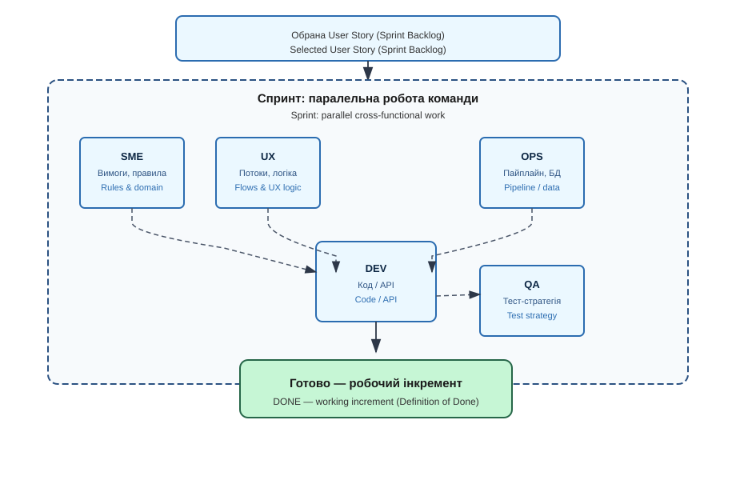

UDC: 004.42:37.01

# SIMULATION OF A FULL SCRUM CYCLE ON A COMPLEX DISTRIBUTED SOFTWARE PROJECT IN A UNIVERSITY WORKSHOP (CASE: VARTA)

## Authors and affiliation

**PLATONOV V.V.** (v.platonov@onu.edu.ua), **PLATONOVA Y.V.** (jane.platonova@onu.edu.ua)  
Odesa National I.I. Mechnikov University, Department of Optimal Control and Economic Cybernetics, Odesa, Ukraine

---

## Abstract

*Agile and Scrum are often taught declaratively, so students remember roles and ceremonies yet remain weak on cross-functional delivery, non-functional constraints, and integration in multi-team settings. This paper reports on an educational simulation: three decentralized squads applied the full Scrum workflow to the fictional product VARTA (Distributed Resilience Orchestrator)—mesh-oriented, offline-first, with demanding security and operations—using a shared project board over two sprints. Squads produced traceable artifacts (domain rules, UX flows, wireframes, technical and operations tasks, test cases) with story points, backlog refinement, sprint planning, daily coordination, sprint review, and retrospective. Quantitative summaries show workload moving from specification-heavy decomposition to implementation and infrastructure, relate over-commitment and missing operations capacity to delivery risk, and yield a reproducible workshop pattern plus evidence-based recommendations for educators preparing developers for complex, distributed products.*

---

## 1. Problem statement

Agile methods are mainstream in software engineering, yet university courses often shrink them to role definitions and meeting lists. Graduates then face a theory–practice gap in multi-team products that demand **vertical slicing** (domain, UX, development, QA, and operations working in parallel on one end-to-end increment), **backlog refinement** before sprint planning, and **cross-squad contracts** under a shared product vision.

A **controlled, realistic simulation** can surface negotiation, estimation bias, integration bottlenecks, and operations-aware **Definition of Done** criteria without a commercial codebase. The research question is whether a **two-sprint** exercise on a **non-trivial fictional product** yields **measurable, interpretable** outcomes that instructors can **reuse** in teaching and that student teams can **unpack in retrospectives**.

## 2. Objectives and tasks addressed

The study had the following objectives:

1. Design and run a multi-squad Scrum simulation aligned with the Scrum Guide and common industry practice (refinement, planning, daily Scrum, review, retrospective).
2. Anchor the simulation in a single complex product brief to force **dependencies**, **security**, and **mesh/offline** constraints rather than toy CRUD examples.
3. Collect **quantitative** indicators from the teams’ project board (ticket counts, types, story-point planning, completion rates) and **qualitative** observations from sprint goals, risks, and retrospective themes documented by squads.

Tasks addressed included: defining squad structure and role rotation; providing ticket templates; supervising Product Owner and Scrum Master functions; and summarizing sprint outcomes in structured internal reports used here as primary data.

## 3. Methodology and workshop setup

**Product.** Teams worked on **VARTA** (Distributed Resilience Orchestrator): a decentralized concept for managing critical resources over mesh networks with offline-first assumptions, cryptographic identity, quota ledgers, telemetry, ethical dispatching, and messaging epics. The product framing intentionally blends socio-technical dilemmas with engineering depth so that “game-like” prioritization and conflict scenarios arise naturally in backlog items.

**Organization.** Approximately **three squads** (Alpha, Beta, Gamma), each cross-functional (subject-matter expert, UX, development, QA, operations). The authors, in faculty roles, acted as **Product Owner** and **Scrum Master** facilitator. Students used a **GitHub Project** board with a naming convention linking epics, user stories, domain rules, edge cases, technical tasks, test cases, and operations tasks. **Supplementary materials** (sprint metrics, backlog snapshots, tooling) are openly available in the repository [https://github.com/Varta-2026/product-backlog](https://github.com/Varta-2026/product-backlog).

**Process.** **Sprint 1** emphasized the first **vertical slice**: one prioritized user story carried end-to-end with parallel contributions from all roles. **Sprint 2** emphasized harder integration paths, API-style **contract-first** expectations between squads, and closure of **operations debt** where it had been missing. Ceremonies followed the standard set; refinement was explicitly distinguished from sprint planning so that planning meetings did not become first-read sessions of opaque stories.

**Data sources.** Aggregated metrics and narrative summaries were taken from sprint documentation maintained alongside the backlog in the public GitHub repository [https://github.com/Varta-2026/product-backlog](https://github.com/Varta-2026/product-backlog) (ticket exports, “sprint_1” and “sprint_2” folders, planning notes, reviews, and metrics tables). Figures and tables below summarize those artifacts without naming individual students, in line with a classroom case-study presentation.

## 4. Results

### 4.1 Sprint planning and commitment

Squad-level planning used a nominal capacity of **40 story points** per sprint. In **Sprint 1**, the recorded commitment was **44 story points** (slight over-commitment). In **Sprint 2**, commitment rose to **60 story points** while capacity remained **40**, indicating **strong over-commitment** and predictable pressure on integration and testing.

### 4.2 Artifact volume and distribution

**Table 1** summarizes ticket volumes created by squads (excluding high-level Product Owner backlog items such as epics and coarse user stories).

**Table 1. Squad-generated tickets and sprint planning (two sprints).**

| Indicator | Sprint 1 | Sprint 2 |
| :--- | :---: | :---: |
| New squad tickets (approx.) | 128 | 99 |
| Planned capacity (SP) | 40 | 40 |
| Committed scope (SP) | 44 | 60 |
| Tickets closed (Sprint 2 only) | — | 76 (76.8%) |
| Tickets still open (Sprint 2 only) | — | 23 (23.2%) |

In **Sprint 1**, the largest shares of squad-generated work were **test cases** (18.8%), **technical tasks** (17.2%), and **user flows** (14.8%), consistent with a first slice that invests heavily in clarification, UX paths, and quality design alongside implementation. **Squad activity shares** were approximately **48.4% (Alpha), 26.6% (Beta), and 25.0% (Gamma)**.

In **Sprint 2**, **technical tasks** (24.2%) and **operations tasks** (23.2%) dominated, while many **test** and **UX flow** tickets from Sprint 1 were relatively fewer in the *new* ticket mix—interpreted here as a **shift from elaboration to build and run**. Operations ticket volume rose sharply compared with Sprint 1 (relative increase on the order of **sixty percent** in the documented comparison), including monitoring, queues, cleanup, and deployment-oriented work. **Squad activity shares** moved to roughly **54.5% (Alpha), 10.1% (Beta), and 35.4% (Gamma)**, reflecting different epic assignments and integration roles rather than uniform “fair” ticket counts per squad.

### 4.3 Qualitative engineering outcomes (selected)

Across squads, Sprint 1 outcomes included coherent vertical slices in identity and trust, quota transfer with CRDT-style offline considerations, and messaging store-and-forward designs. Sprint 2 added **telemetry ingestion**, **threshold alerting**, **ethical dispatcher** logic, **peer messaging** and **emergency broadcast** flows, and explicit **API contract** work intended to unblock dependent squads. Retrospective-style notes recorded risks such as **API bottlenecks**, **very large stories** (e.g., high story-point items without decomposition), and **missing operations participation** in one squad during Sprint 1, later corrected by concentrated operations work in Sprint 2.

**Fig. 1 –** Vertical slice (Agile): parallel work by SME, UX, DEV, OPS, and QA roles within one sprint toward a working increment. Labels on the figure are given in **Ukrainian** (primary role descriptions) and **English** (secondary line). Vector source file: `figures/CGM2026_fig1_vertical_slice.svg` (for Word, import the SVG or embed a PNG export).

## 5. Discussion

The metrics support three teaching insights.

First, **over-commitment** is pedagogically valuable only if time is reserved for structured reflection; otherwise it collapses into chaos. Here, raising commitment from 44 to 60 SP on the same nominal capacity made **integration risk** and **open test work** visible.

Second, **operations** is not an optional label: when one squad under-produced operations tickets early, later sprints showed compensating **ops-heavy** work and infrastructure themes (monitoring, storage lifecycle, broadcast storm control). That pattern mirrors industry **“you build it, you run it”** pressure.

Third, **contract-first interfaces** between squads (for example, device identity and messaging contracts) reduced ambiguity but required coordination by the faculty supervisors to prioritize them as shared deliverables—similar to a **platform team** dependency in large products.

## 6. Conclusions

The workshop demonstrated that a **two-sprint, three-squad Scrum simulation** on a **complex mesh-oriented product** can produce **large, typed, traceable backlogs** and **interpretable metrics** suitable for software-engineering education within the **“education and science”** track of a multimedia-and-games-oriented conference: the scenario embeds **serious socio-technical trade-offs** and **resource-allocation narratives** adjacent to game-design thinking while remaining a software-process case study.

Practical recommendations for repeating the format:

1. Enforce **backlog refinement** before sprint planning and forbid “first read” of stories in the planning meeting.
2. Cap or **split** stories above a agreed story-point threshold (for example, require decomposition before commitment).
3. Mandate **operations** tasks and **Definition of Done** checks that include **offline / mesh-disruption** scenarios.
4. Introduce **contract-first** artifacts for any interface that couples squads, with explicit acceptance criteria for consumers.

Future work could add a third sprint with **full role rotation**, compare outcomes across cohorts, and correlate qualitative peer assessments with ticket metrics.

## LIST OF REFERENCES

[1] K. Schwaber and J. Sutherland, “The Scrum Guide: The Definitive Guide to Scrum: The Rules of the Game,” Scrum.org, Nov. 2020. [Online]. Available: https://scrumguides.org/scrum-guide.html

[2] V. Varenik and Zh. Piskova, “Implementing Elements of the Scrum Methodology in the Educational Process in Ukraine: New Horizons for Developing Communicative Competencies,” *Pedagogical Sciences*, no. 85, pp. 14–24, 2025, doi: 10.33989/2524-2474.2025.1.14. [Online]. Available: https://doi.org/10.33989/2524-2474.2025.1.14

[3] Yu. P. Shapran and T. O. Zhyrova, “Pedagogical Interpretation of Agile Methodology Principles in Training Future IT Specialists,” *Pedagogical Almanac*, no. 61, pp. 85–93, 2026, doi: 10.37915/pa.vi61.702. [Online]. Available: https://doi.org/10.37915/pa.vi61.702

[4] A. V. Chorna, “Scrum Methodology as a Practical Method for Training Software Engineers,” *Information Technologies in Education and Science: Collected Scientific Papers*, issue 1(9), pp. 287–291, 2017.

[5] T. Dyba and T. Dingsoyr, “Empirical studies of agile software development: A systematic review,” *Information and Software Technology*, vol. 50, no. 9–10, pp. 833–859, 2008.

[6] H. Sharif and K. J. Abran, “A framework for teaching agile software development: A university case study,” in *Proc. 14th Conf. Softw. Eng. Educ. Training*, 2001, pp. 204–211.

---

**Author name notes (for the manuscript header).** (1) In Ukrainian administrative style: **Платонов Віталій Валерійович**. In English, **V.V. PlatonoV** is typical; patronymic **Valeriiovych** (Ukrainian-style Latin) or **Valeriyovich** (common legacy spelling)—match the passport or university registry. (2) Co-author **Платонова Євгеній Вікторівна** as requested; note that the patronymic **Вікторівна** is grammatically paired with the female given name **Євгенія**—if official documents use **Євгенія Вікторівна**, use that spelling in the Ukrainian title page. In English headers: **Y.V. Platonova** (for **Yevheniia Viktorivna**); adjust initials if the registry spelling differs. Title-block contact e-mails: **v.platonov@onu.edu.ua**, **jane.platonova@onu.edu.ua**.
