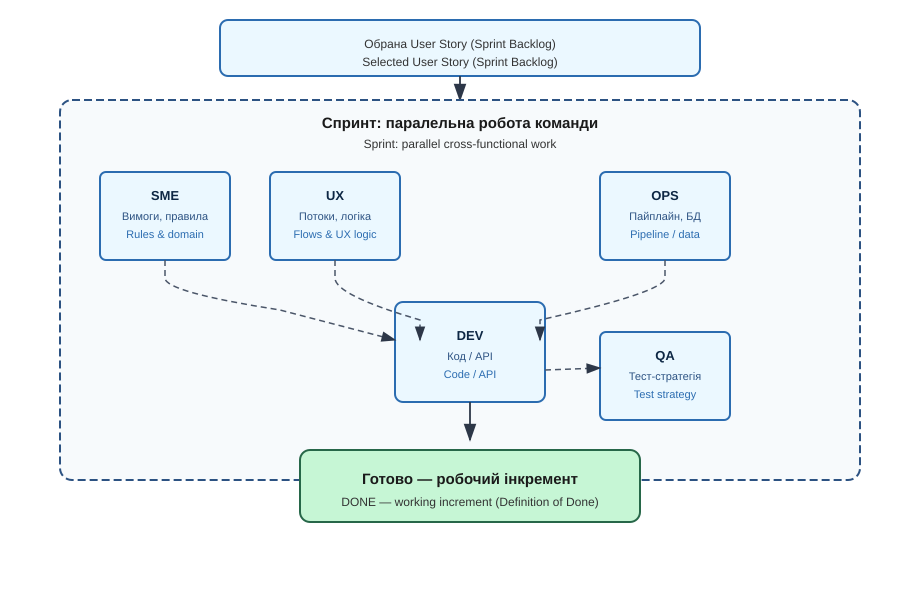

УДК: 004.42:37.01

# СИМУЛЯЦІЯ ПОВНОГО ЦИКЛУ SCRUM НА СКЛАДНОМУ РОЗПОДІЛЕНОМУ ПРОГРАМНОМУ ПРОЄКТІ В УНІВЕРСИТЕТСЬКОМУ ВОРКШОПІ (ПРИКЛАД VARTA)

## Автори та афіліація

**ПЛАТОНОВ В.В.** (v.platonov@onu.edu.ua), **ПЛАТОНОВА Є.В.** (jane.platonova@onu.edu.ua)  
Одеський національний університет імені І. І. Мечникова, кафедра оптимального керування та економічної кібернетики, м. Одеса, Україна

---

## Анотація

*Agile та Scrum нерідко подають декларативно: студенти запам’ятовують ролі й церемонії, але слабо готуються до кросфункціональної поставки, нефункціональних обмежень і ризиків інтеграції в багатокомандному середовищі. Описано освітню симуляцію: три децентралізовані сквади пройшли повний цикл Scrum на вигаданому продукті VARTA (Distributed Resilience Orchestrator) — mesh-орієнтована, offline-first концепція з високими вимогами до безпеки та експлуатації; робота велась на спільній Kanban/Project-дошці протягом двох спринтів. Створено відстежувані артефакти — доменні правила, користувацькі потоки, wireframes, технічні та операційні задачі, тест-кейси — зі story points, уточненням беклогу, плануванням спринту, щоденними узгодженнями, оглядом і ретроспективою. Кількісні узагальнення показують зсув навантаження від проєктно-аналітичної декомпозиції до реалізації й інфраструктури, зв’язок овербукінгу та дефіциту ролі Ops із ризиками поставки, а також дають відтворювану схему воркшопу й обґрунтовані рекомендації для викладачів, які готують розробників до складних розподілених продуктів.*

---

## 1. Постановка проблеми

Agile-методології домінують у промисловій розробці ПЗ, проте університетські курси нерідко зводять їх до визначень ролей і переліку зустрічей; випускники стикаються з розривом теорії й практики в багатокомандних продуктах, де потрібні **вертикальні зрізи** (паралельна робота експертів предметної області, UX, розробки, QA та Ops над одним наскрізним інкрементом), **постійне уточнення беклогу** до планування спринту та **крос-сквадні контракти** за спільного бачення продукту.

**Керована, але реалістична симуляція** демонструє переговори, упередження в оцінюванні, вузькі місця інтеграції та критерії готовності з урахуванням експлуатації без розкриття комерційного коду. Науково-методичне питання: чи забезпечує **двоспринтова** симуляція на **нетривіальному вигаданому продукті** **вимірювані, інтерпретовані** результати, придатні для аналізу в освітньому процесі та **повторення іншими викладачами**.

## 2. Мета та перелік вирішуваних завдань

**Мета** — зафіксувати досвід проведення багатосквадної Scrum-симуляції та оцінити її ефективність за об’єктивними показниками беклогу й якісними спостереженнями.

**Завдання:**

1. Спроєктувати й провести симуляцію повного циклу Scrum (уточнення беклогу, планування, щоденні зустрічі, огляд, ретроспектива) для трьох сквадів за узгодженими з індустрією правилами [1].
2. Закріпити симуляцію за **одним складним продуктовим брифом**, щоб стимулювати залежності між командами, вимоги до безпеки та сценарії розриву mesh/офлайн-зв’язку.
3. Зібрати **кількісні** показники з дошки проєкту (кількість і типи тікетів, story points, статуси виконання) та **якісні** спостереження з планів, оглядів і ретроспективних нотаток.

## 3. Сутність дослідження (методика та організація воркшопу)

**Продукт.** Учасники працювали над **VARTA** (Distributed Resilience Orchestrator) — концепцією децентралізованої мережі керування критичними ресурсами (енергія, вода, зв’язок) для міських громад за умов деградації центральної інфраструктури; передбачені епіки ідентифікації та довіри, квотних реєстрів, телеметрії, етичного диспетчеризаційного керування та mesh-комунікації. Такий фрейм навмисно поєднує **соціально-технічні дилеми** з глибокою інженерією, наближаючи сценарії до «серйозних ігор» і пріоритезації ресурсів без спрощення до навчальних CRUD-прикладів.

**Організація.** Сформовано **три сквади** (Alpha, Beta, Gamma), кожен — **кросфункціональний** (ролі SME, UX, Dev, QA, Ops з можливістю ротації). Автори у викладацьких ролях виконували функції **Product Owner** та фасилітатора **Scrum Master**. Облік вівся в **GitHub Project** з уніфікованою конвенцією іменування тікетів (доменні правила DR, граничні випадки EC, технічні задачі TT, тест-кейси TC, Ops тощо) і прив’язкою до епіків. **Додаткові матеріали** (метрики спринтів, знімки беклогу, інструменти) відкрито розміщено в репозиторії [https://github.com/Varta-2026/product-backlog](https://github.com/Varta-2026/product-backlog).

**Процес.** **Спринт 1** був зорієнтований на перший **вертикальний зріз**: одна пріоритетна user story наскрізь із паралельним внеском усіх ролей. **Спринт 2** — на складніші зв’язки, інтеграцію, **contract-first** очікування щодо API між сквадами та закриття **операційного боргу**, виявленого в попередній фазі. Окремо підкреслювалася різниця між **Product Backlog Refinement** і **Sprint Planning**, щоб планування не перетворювалося на «перше читання ТЗ».

**Емпірична база.** Підсумкові таблиці метрик і описи результатів спринтів підготовлено як документацію курсу поруч із беклогом у відкритому репозиторії GitHub [https://github.com/Varta-2026/product-backlog](https://github.com/Varta-2026/product-backlog) (експорт тікетів, каталоги «sprint_1» та «sprint_2», нотатки планування, огляди); у тезах використано агреговані показники без персональних оцінок студентів.

## 4. Результати

### 4.1 Планування та зобов’язання за story points

Умовна **capacity** спринту — **40 SP**. У **Спринті 1** задокументоване зобов’язання — **44 SP** (легкий овербукінг). У **Спринті 2** зобов’язання — **60 SP** при тій самій номінальній capacity (**40 SP**), тобто **критичний овербукінг**, що відображає типовий навчальний ризик «взяти забагато» без достатньої декомпозиції.

### 4.2 Обсяг і структура артефактів

**Таблиця 1** узагальнює кількісні показники (тікети, створені сквадами; SP; статуси у Спринті 2).

**Таблиця 1. Показники симуляції за двома спринтами.**

| Показник | Спринт 1 | Спринт 2 |
| :--- | :---: | :---: |
| Нових тікетів від сквадів (орієнтовно) | 128 | 99 |
| Планова capacity (SP) | 40 | 40 |
| Фактичне зобов’язання (SP) | 44 | 60 |
| Закрито тікетів (лише Спринт 2) | — | 76 (76,8%) |
| Відкрито тікетів (лише Спринт 2) | — | 23 (23,2%) |

У **Спринті 1** найбільші частки серед типів робіт: **тест-кейси** — 18,8%, **технічні задачі** — 17,2%, **user flows** — 14,8%, що відповідає фокусу на уточненні вимог, UX-потоках і якості. Розподіл активності між сквадами: **Alpha — 48,4%, Beta — 26,6%, Gamma — 25,0%**.

У **Спринті 2** домінують **технічні задачі** (24,2%) та **Ops-задачі** (23,2%); частка нових тест-кейсів і окремих UX-артефактів у «дельті» спринту нижча, ніж у першому, що інтерпретується як **зсув до реалізації та інфраструктури**. Кількість Ops-тікетів зросла порівняно зі Спринтом 1 приблизно на **64%** (за внутрішнім порівнянням у звіті метрик). Розподіл за сквадами: **Alpha — 54,5%, Beta — 10,1%, Gamma — 35,4%** (різниця пояснюється розподілом епіків і інтеграційними ролями, а не «рівним» обсягом тікетів на команду).

### 4.3 Приклади інженерних результатів (узагальнено)

У **Спринті 1** сквади сформували узгоджені вертикальні зрізи в темах ідентифікації та довіри, передачі квот із вимогами узгодженості даних у офлайні, mesh-комунікації та криптографічних механізмів. У **Спринті 2** додано телеметрію та порогові сповіщення, етичний диспетчер, peer messaging і emergency broadcast, а також явні **API-контракти** для розблокування залежних команд. У якісних нотатках зафіксовано ризики: **пляшкове горлечко** на спільних контрактах, **великі історії** без дроблення (наприклад, поріг порядку **13 SP** як сигнал для декомпозиції), **відсутність Ops** у одному скваді на ранній фазі та подальше **закриття Ops-боргу** в наступному спринті.

**Рис. 1 –** Вертикальний зріз (Agile): паралельна робота ролей SME, UX, DEV, OPS, QA в межах одного спринту до робочого інкременту. Підписи на рисунку дубльовані українською та англійською мовами. Файл векторного рисунка: `figures/CGM2026_fig1_vertical_slice.svg` (для Word — імпорт SVG або експорт у PNG з цього файлу).

## 5. Обговорення

Отримані дані підтверджують три методичні тези.

**По-перше**, овербукінг корисний для навчання лише за наявності структурованої рефлексії; інакше він лише демотивує. Стрибок зобов’язання з **44** до **60 SP** при **40 SP** capacity зробив видимими інтеграційні затримки та незавершені QA-артефакти.

**По-друге**, **Ops** не є «додатковою роллю»: коли на старті один сквад майже не створював Ops-тікетів, наступний спринт компенсував це **пакетом інфраструктурних** задач (моніторинг, черги, TTL, середовища тестування офлайну), що віддзеркалює індустріальну логіку супроводу.

**По-третє**, **contract-first** зменшує невизначеність між сквадами, але вимагає узгодженої пріоритезації спільних артефактів з боку авторів — аналогічно до залежностей від платформенних команд у великих продуктах.

## 6. Висновки

1. Двоспринтова багатосквадна симуляція на продукті класу **VARTA** дозволяє отримати **великий типізований беклог** і **відтворювані метрики**, придатні для аналізу в курсі інженерії ПЗ у рамках секції **«Освіта та наука»** конференції CGM 2026: сценарій поєднує **серйозні сценарії комунікації та пріоритезації** з інженерією ПЗ без обов’язкової прив’язки до розважального ігрового релізу.

2. Для повторення воркшопу доцільно: (а) **заборонити** планування без попереднього refinement; (б) **обмежувати** або дробити історії великої ваги в SP; (в) **закріпити в DoD** перевірки в умовах **офлайну / розриву mesh**; (г) вводити **обов’язкові контракти** для міжсквадних інтерфейсів.

3. Перспектива — третій спринт із **повною ротацією ролей**, порівняння когорт, кореляція метрик дошки з peer review.

## СПИСОК ВИКОРИСТАНОЇ ЛІТЕРАТУРИ

[1] K. Schwaber and J. Sutherland, “The Scrum Guide: The Definitive Guide to Scrum: The Rules of the Game,” Scrum.org, Nov. 2020. [Online]. Available: https://scrumguides.org/scrum-guide.html

[2] Вареник В., Піскова Ж. Впровадження елементів методології Scrum в освітньому процесі в Україні: нові горизонти для розвитку комунікативних компетентностей // Педагогічні науки. — 2025. — Вип. 85. — С. 14–24. — DOI: https://doi.org/10.33989/2524-2474.2025.1.14

[3] Шапран Ю. П., Жирова Т. О. Педагогічна інтерпретація принципів Agile-методології у підготовці майбутніх ІТ-фахівців // Педагогічний альманах. — 2026. — Вип. 61. — С. 85–93. — DOI: https://doi.org/10.37915/pa.vi61.702

[4] Чорна А. В. Scrum методологія, як практичний метод підготовки інженерів-програмістів // Інформаційні технології в освіті та науці : зб. наук. пр. — 2017. — Вип. 1 (9). — С. 287–291.

[5] T. Dyba and T. Dingsoyr, “Empirical studies of agile software development: A systematic review,” *Information and Software Technology*, vol. 50, no. 9–10, pp. 833–859, 2008.

[6] H. Sharif and K. J. Abran, “A framework for teaching agile software development: A university case study,” in *Proc. 14th Conf. Softw. Eng. Educ. Training*, 2001, pp. 204–211.

---

**Примітки щодо імен для офіційних документів.** (1) **Платонов Віталій Валерійович** (по батькові від **Валерій** → **Валерійович**); у латиниці для заголовка тез — **PlatonoV V.V.**; по батькові латинкою: **Valeriiovych** (ДСТУ) або **Valeriyovich** (поширена латинізація). (2) Співавторка за вашим формулюванням: **Платонова Євгеній Вікторівна**; по батькові **Вікторівна** граматично відповідає імені **Євгенія** (якщо в паспорті / наказі саме **Євгенія Вікторівна**, використовуйте його на титулі). У латиниці: **Platonova Y.V.** для **Yevheniia Viktorivna**. Контактні e-mail у шапці: **v.platonov@onu.edu.ua**, **jane.platonova@onu.edu.ua**. Узгодьте всі форми з паспортом або наказом університету.
